# Insight — find any file instantly (macOS · Windows · Linux)

A fast, private file search app in the spirit of *Everything* for Windows, built for macOS first and also
available for Windows and Linux. 100% Rust, one native binary, no Electron, no background daemon, no cloud.

It indexes every file on your computer in seconds, finds files as you type, shows where your disk space goes,
keeps an eye on your computer's health, cleans junk like CleanMyMac / [Mole](https://github.com/tw93/Mole), and lets
you search your photos by what's in them, all on your own machine. It keeps itself up to date.

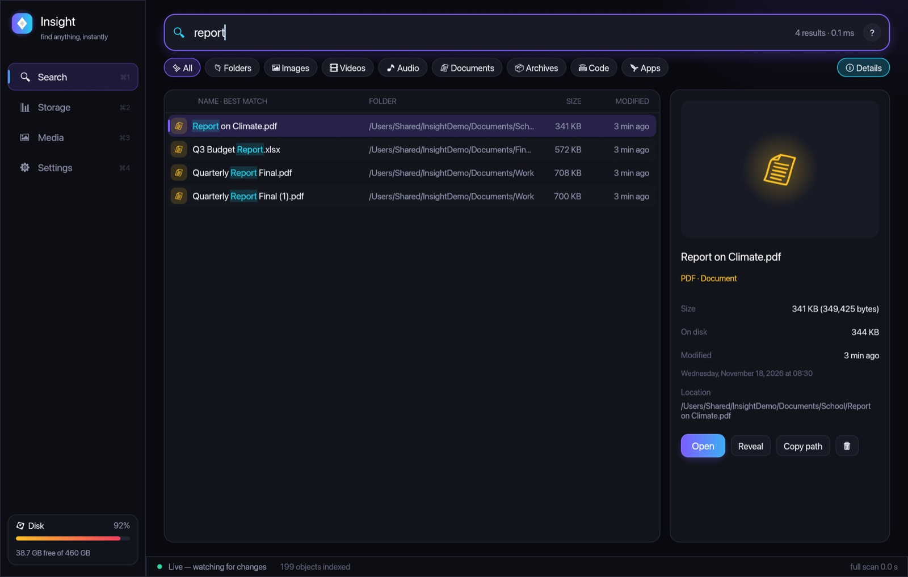

| Storage insights | Cleanup, biggest files, duplicates |
|---|---|
| 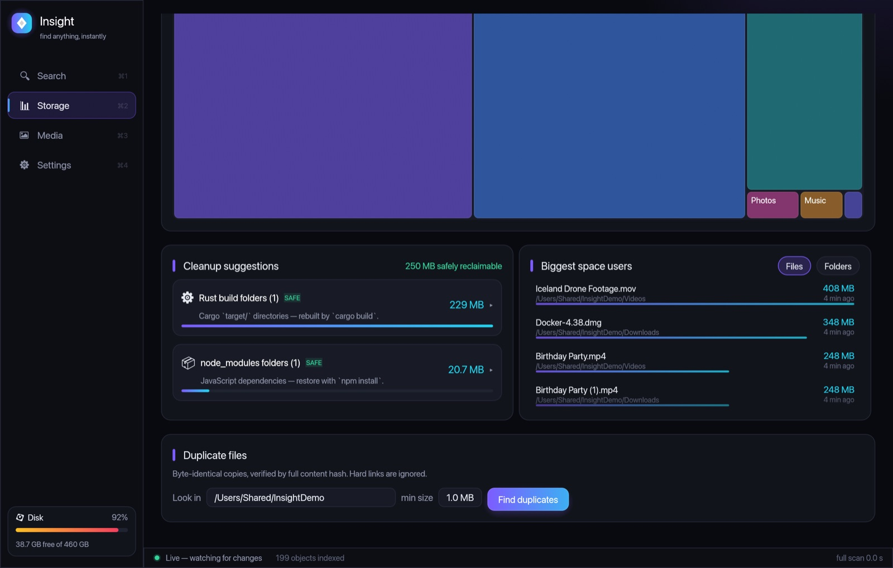 | 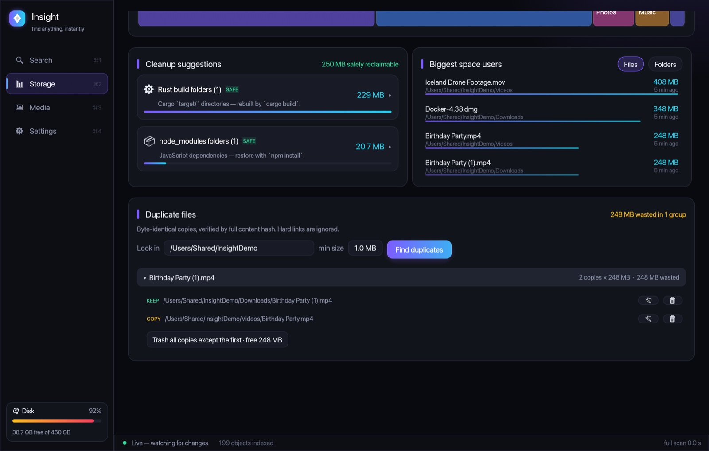 |

| Health (live) | Cleanup toolbox |
|---|---|
| 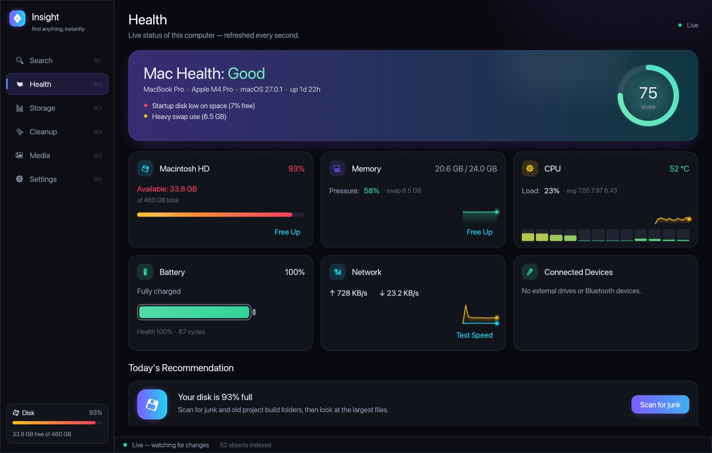 | 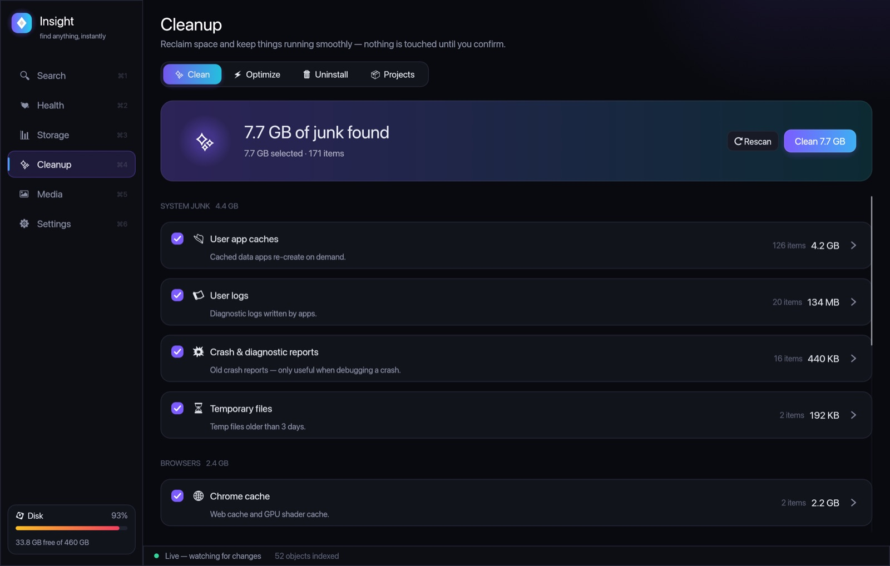 |

| Apps grouped by the app that owns them | |
|---|---|
| 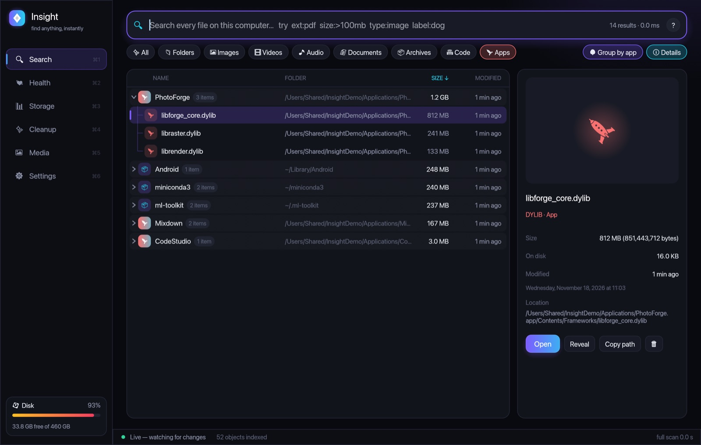 | |

| Organize photos: editable preview | Organize options |
|---|---|
| 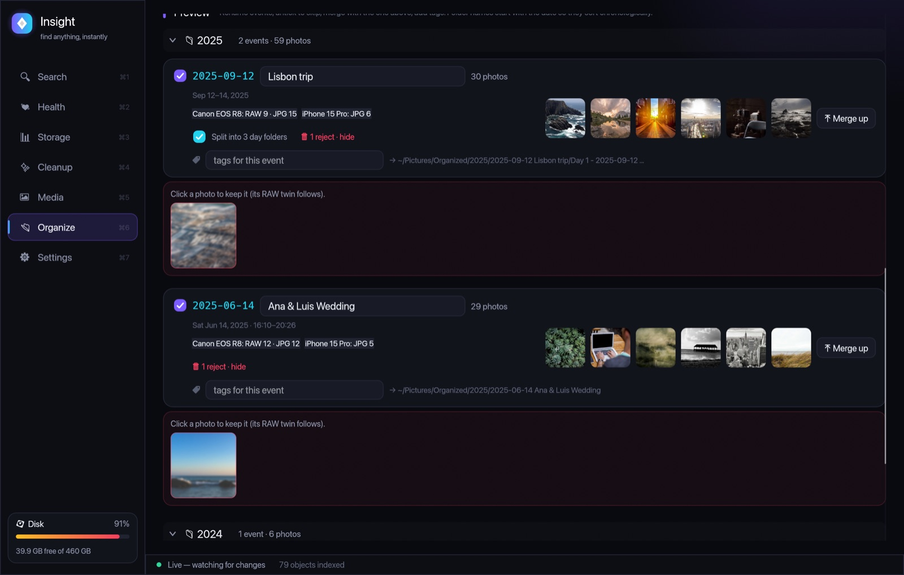 | 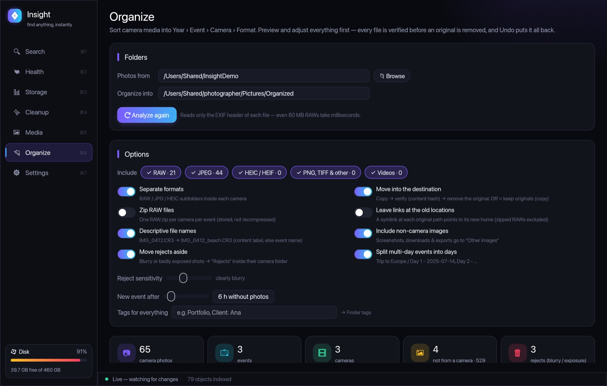 |

| Planned folders map (Organize) | Photo folder map (Media) |
|---|---|
| 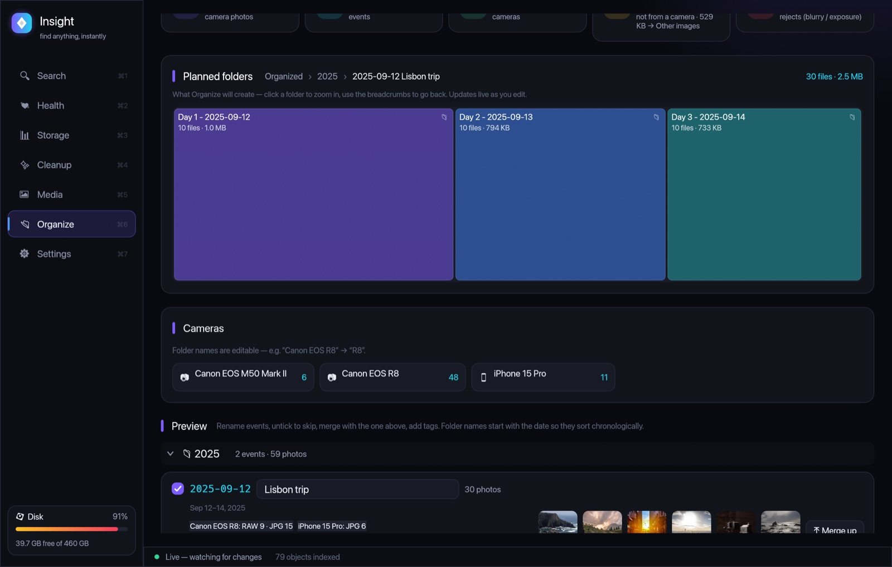 | 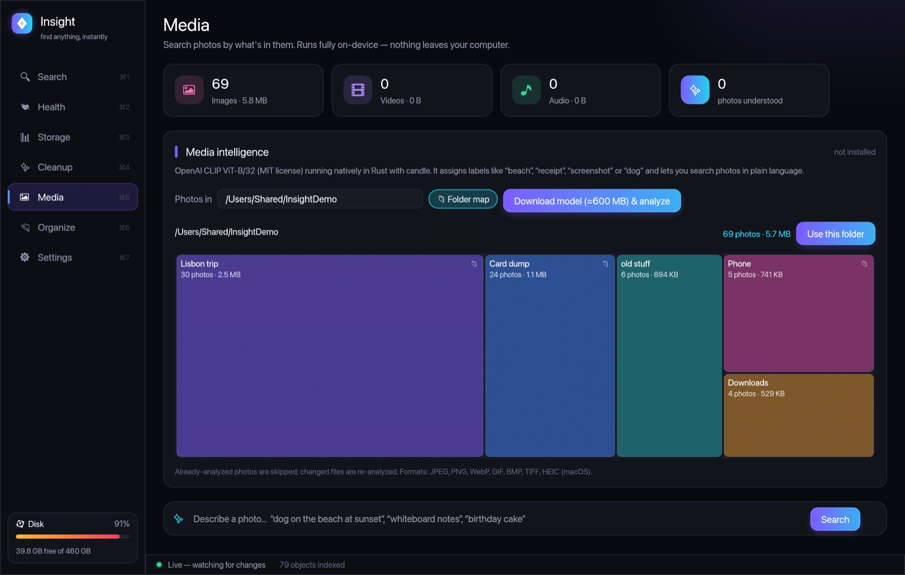 |

| Media labels | Search photos in plain language |
|---|---|
| 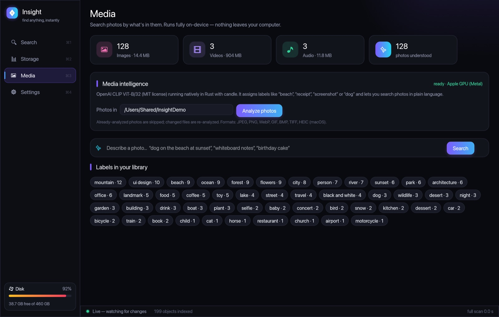 |  |

## Why use it?

Spotlight is built for "open that app" and document contents. It skips system and hidden folders, ranks
unpredictably, and can't tell you *where your 400 GB went*. Finder search is slow. Insight is a file finder that
does one job quickly.

- **Instant:** results update on every keystroke, in 2–10 ms across 2.6 million files.
- **Everything, really:** system folders, hidden dot-files, `node_modules`, app bundles, external drives you add.
- **Live:** file changes show up within a second (FSEvents on macOS, ReadDirectoryChanges on Windows, inotify on Linux).
- **Opens instantly:** the index is saved to disk, so a 2.6-million-file index is ready about 0.25 s after launch.
- **Storage insights:** a zoomable space map, space by type, largest files and folders, safe cleanup suggestions,
  and a duplicate finder that verifies with full content hashes.
- **Health at a glance:** a live, CleanMyMac-style panel with a 0–100 health score, disk, memory pressure, CPU
  load and temperature, battery, network speed (with a speed test), connected drives and Bluetooth batteries,
  and the apps using the most memory and CPU.
- **Cleanup toolbox:** junk cleaning, one-click maintenance, an uninstaller that finds an app's leftovers, and a
  project-folder purge.
- **Always current:** checks GitHub releases, downloads updates in the background, verifies them with SHA-256 and
  installs them when you quit.
- **Photo organizer for messy photographers:** point it at a card dump or a chaotic Pictures folder and it
  sorts camera photos into `2025 / 2025-07-14 Wedding / Canon EOS R8 / RAW`, moves blurry shots to `Rejects`,
  and shows an editable preview first. Files are moved only after each copy is verified by content hash, and
  Undo puts everything back.
- **Photos by content:** an on-device AI model labels your photos (beach, receipt, screenshot, dog…) and lets you
  search them in plain language (*"mountains reflected in a lake"*).
- **Private:** nothing is uploaded. Network use is limited to the update check (GitHub), the one-time model
  download if you turn the media feature on, and the speed test when you click it.

## Performance

Measured on a MacBook Pro (Apple M4 Pro, 12 cores, 24 GB, macOS 27), indexing the whole startup disk:
**2,630,000 files and folders**. Search times come from `insight --cli` with a warm index (best of 3).

| | Typical approach | Insight | |
|---|---:|---:|---|
| First full index of the disk | 94 s (`readdir` + `stat` per file, parallel) | **7.3–8.2 s** | ~12× faster |
| Launch to searchable (saved index) | full rescan | **0.25 s** | |
| Search `report` / `main.rs` | — | **3.9 / 4.2 ms** | |
| Search `ext:pdf size:>10mb` / `type:image dm:week` | — | **2.2 / 2.2 ms** | |
| Search `*.rs` (23,822 hits) / `IMG_????.jpg` | — | **2.7 / 5.4 ms** | |
| Search a path fragment `src/main` | — | **9.6 ms** | |
| Spotlight `mdfind -name main.rs` (for reference) | 50–70 ms | | narrower scope |
| Storage analysis (sizes, suggestions, largest) | — | **68 ms** | |
| Junk scan (caches, logs, browser & developer caches, leftovers) | — | **0.4 s** (7.7 GB in 11 categories) | |
| Find project build folders (`node_modules`, `target`…) | walk the disk | **17 ms** (answered from the index) | |
| List installed apps with sizes | — | **1.2 s** (66 apps) | |
| Health panel refresh | — | **1×/s**, sampler idle when the page is hidden | |
| Organize: read camera data (2,058 photos, JPEG + CR3) | — | **0.6 s** | headers only |
| Organize: focus / exposure check | — | **≈160 photos/s** (12.6 s for 2,058) | optional |
| Photo understanding (CLIP ViT-B/32) | — | **91 img/s** on the Apple GPU, 42 img/s on CPU | |
| App download | — | **12 MB** (universal macOS zip) | |

**Trade-offs, honestly:**
- **Memory:** about **600 MB** with 2.6M files indexed (around 230 bytes per file for names, metadata and the
  lookup table, plus the UI). Index fewer folders and it shrinks proportionally. The photo model adds about
  600 MB, and only once you open the Media tab.
- **The saved index takes disk space:** 134 MB for 2.6M files.
- **The first launch scans everything** (8 s here; slower on spinning disks or with many network mounts).
  Later launches are instant, then a background refresh catches changes made while Insight was closed.
  You can turn that off in Settings.
- **macOS privacy:** some folders (Mail, Messages, Safari…) only become visible after you grant
  **Full Disk Access**.
- **Linux live updates** watch your home folder, since inotify can't cheaply watch a whole disk. Other locations
  update on the next rescan.
- **Videos** are searchable by name, type, size and date, but the AI model labels still images only.
- **Cleaning deletes caches permanently** (like Mole and CleanMyMac — moving 8 GB of cache to the Trash
  frees nothing). Uninstalls, login items and storage suggestions go through the Trash. Everything asks first.
- **Some maintenance tasks need your password** (flush DNS, free RAM, reindex Spotlight); they're marked 🔒.
- **Bluetooth battery levels** are macOS-only. On Windows and Linux the uninstaller drives the system's own
  uninstallers / Flatpak / Snap rather than deleting files itself.
- The macOS app is ad-hoc signed, not notarized (no paid Apple developer account). The installer handles this.

## Features

**Search**
- Results on every keystroke, ranked by best match (exact name, then prefix, then word start), or sorted by
  name, folder, size or date.
- Filter chips: Folders, Images, Videos, Audio, Documents, Archives, Code, Apps.
- Matches highlighted in the results, plus a detail panel with a preview, size, dates, full path and AI labels.
- Keyboard first: type anywhere to search, ↑/↓ to move, **Enter** to open, **⌘/Ctrl+Enter** to reveal in
  Finder/Explorer, **⌘/Ctrl+C** to copy the path, **Esc** to clear. **⌘1–7** switch tabs.
- Right-click a result to open, reveal, copy the path or name, or move it to the Trash.

- **Group by app:** the Apps filter shows results as a tree under the app or package that owns them
  (`Affinity Photo 2.app` → its 60 libraries, `~/.lmstudio`, Homebrew's `llvm`…), with group totals,
  sortable by size, name or date, with app sizes measured on disk. **⊞ / ⊟** in the header expand or collapse
  every group. Toggle the tree for any search with **🌳 Group by app**.
- **Fuzzy search:** when a query finds fewer than 25 exact matches, Insight adds names containing your letters
  in order (`affphoto` → *Affinity Photo*) or with one typo (`photshop` → *Photoshop*), ranked after exact hits,
  with the matched letters highlighted. Still 11–16 ms over 2.5M files.
- **Clear** the search with the ✕ in the search bar (or Esc).

**Query syntax** (terms combine with AND; matching ignores case)

| Query | Meaning |
|---|---|
| `foo bar` | name contains *foo* and *bar* |
| `"foo bar"` | exact phrase |
| `!foo` or `-foo` | exclude |
| `jpg\|png` | either |
| `*.rs`, `IMG_????.jpg` | wildcards on the whole name |
| `src/main`, `path:projects`, `in:Downloads` | match the full path |
| `ext:pdf,docx` | by extension |
| `type:image\|video` | folder, image, video, audio, doc, archive, code, app, other |
| `file:` / `folder:` | only files / only folders |
| `size:>100mb`, `size:1mb..1gb` | by size |
| `dm:today`, `dm:week`, `dm:>2024-01`, `dm:old` | by date modified |
| `label:dog`, `label:receipt` | by AI photo label |
| `re:^IMG_\d+` | regular expression |
| `hidden:no` | skip dot-files |
| `affphoto`, `photshop` | fuzzy: letters in order or one typo — kicks in when exact hits are few (toggle **≈ Fuzzy**) |
| `fuzzy:no` | exact matches only |

**Storage**
- Disk usage rings and *space by type* (click a type to list its biggest files).
- **Space map:** a squarified treemap you can zoom into folder by folder, with animated transitions.
- **Cleanup suggestions** with sizes and SAFE / REVIEW badges: app caches, Xcode DerivedData and simulators,
  `node_modules`, Rust `target/`, Python caches and virtualenvs, package-manager caches (npm, yarn, pip, cargo,
  gradle, maven, Homebrew), Docker disk images, device backups, Trash, installers left in Downloads, and large
  files untouched for a year. Every item can be revealed first. Deleting always goes through the Trash, never
  permanently.
- **Biggest space users:** the largest files, and the largest folders that actually hold the data
  (not every parent of it).
- **Duplicate finder:** groups by size, then a quick sampled hash, then a full xxh3 content hash. Hard links
  are not counted as duplicates. Keep one copy, trash the rest.

**Health**
- Score from 0–100 with the reasons it dropped (low disk, memory pressure, sustained CPU load, heat, battery
  wear, heavy swap, long uptime), like Mole's `mo status`.
- Cards for disk (→ **Free Up** opens the cleaner), memory pressure with **Free Up** (releases inactive memory),
  CPU load, temperature, per-core bars, battery charge, time left, health and cycles, network up/down with a
  **Test Speed** button, external drives with eject, and Bluetooth devices with battery levels.
- *Today's recommendation* picks the most useful next step; top memory / CPU apps can be quit from the list.

**Cleanup** (inspired by [Mole](https://github.com/tw93/Mole) and CleanMyMac)
- **Clean:** user caches, logs, crash reports, Trash, old temp files, Safari / Chrome / Firefox / Edge / Brave /
  Arc caches, Xcode DerivedData and device support, simulator caches, Homebrew, npm, pnpm, yarn, pip, Go, Cargo,
  Gradle, CocoaPods and JetBrains caches, plus leftovers of apps you already removed (marked REVIEW, never
  pre-selected). Expand any category to pick individual items.
- **Optimize:** flush DNS, free RAM, rebuild Quick Look thumbnails, rebuild Launch Services ("Open With"
  duplicates), reset font caches, reindex Spotlight, restart Finder & Dock, verify the startup disk — one by one
  or **Run recommended**. Lists login & background items, and removes the ones you don't want.
- **Uninstall:** every app with its size and the files it spread around `~/Library` (caches, logs, saved state,
  preferences, containers, launch agents, helpers). Personal data is listed but kept unless you tick it. Warns
  when the app is still running.
- **Projects:** rebuildable build folders (`node_modules`, `target`, `.build`, `build`/`dist`, `.next`, `Pods`…)
  — only when the marker file proving they're rebuildable sits next to them. Folders touched in the last 7 days
  stay unticked.

**Updates**
- Checks GitHub releases at launch and every 6 hours, downloads this platform's build in the background and
  verifies it against the release's `SHA256SUMS.txt` — no matching checksum, no install.
- A sidebar banner offers **Restart & update**; otherwise the update is swapped in when you quit. The swap is an
  atomic rename, so a failed update leaves the current version untouched. Both behaviours can be turned off in
  Settings → Updates.

**Organize** (photos, fully on device, free)
- **Only real camera photos:** a file is organized when its EXIF has a camera make/model and a capture time
  (JPEG, HEIC, PNG/TIFF, and RAW: CR3, CR2, NEF, ARW, RAF, DNG, ORF, RW2…; only the header is read).
  Camera **videos** (MP4/MOV, dated from the file header) join their event in a `Videos` folder. Screenshots,
  downloads and exports without camera data go to `Other images`, or stay put if you switch that off.
- **Structure:** `Year / YYYY-MM-DD Event / Camera / RAW | JPG | HEIC | Other formats`. Event folders start with
  the date so they sort chronologically. Cameras get readable names (`Canon EOS R8`, `iPhone 15 Pro`,
  `Canon EOS M50 Mark II`) that you can rename.
- **Events** are found by gaps in capture time (adjustable, default 6 h) across all cameras, so the iPhone and
  the R8 at the same wedding land together. Back-to-back days from one named folder stay one event
  (`Lisbon trip`). **Split into days** gives `Lisbon trip / Day 1 - 2025-09-12 / …`.
- **Suggested names** come from your folder names (ignoring `DCIM`, `100CANON`, `Card dump`…), else from the
  on-device photo labels (*Dog*, *Food*, *Wedding*), else the time of day. Rename any of them in the preview.
- **Descriptive file names:** `IMG_0412.CR3` → `IMG_0412_beach.CR3` (content label, else the event name); RAW
  files borrow their JPEG twin's label.
- **Rejects:** a fast focus and exposure check (Laplacian sharpness of the best region, on a ⅛-scale decode or
  the CR3's built-in preview) moves missed-focus, motion-blurred and black or blown-out frames to `Rejects` inside
  their camera folder. Shallow depth of field is fine, because only frames with *nothing* sharp are rejected.
  RAW+JPEG twins move together. Adjust the sensitivity, then review the rejects with thumbnails and click to keep one.
- **Formats:** pick RAW / JPEG / HEIC / other, keep them in separate folders or together, and optionally pack RAWs
  into one `RAW.zip` per camera and event.
- **Tags:** for everything and per event: Finder tags on macOS, `user.xdg.tags` on Linux, and on Windows XMP sidecars
  (`IMG_0412.CR3.xmp`, `dc:subject` keywords) that Lightroom, Capture One, Bridge and darktable read. Existing
  sidecars are never overwritten.
- **Planned folders map:** a zoomable treemap (like the storage map) of exactly what will be created,
  `Organized › 2025 › 2025-09-12 Lisbon trip › Day 1 › Canon EOS R8 › RAW`. It updates live as you rename,
  merge or toggle options.
- **Three transfer methods:**
  - **🛡 Safest (default):** clone a backup and verify it, **move the original file itself**, verify the moved
    file against the original's content hash (xxh3-128), then delete the backup. Because the organized file *is*
    the original, its creation date, modified date, Finder tags and other extended attributes are untouched.
    Verified on 2,070 real files: same inode, creation date, modified date and attributes for every file.
    On the same drive the safety clone is free (APFS).
  - **⚡ Fast:** move. On the same drive that's an instant rename (metadata intact); on another drive it's
    copy → verify → remove.
  - **📋 Copy:** verified copies, originals stay. Copies are new files, so their creation date is today.
  Folders a move leaves empty are removed; zipped RAWs are verified member by member before originals go.
- **Links back** (off by default): after a move, a symlink at each original path points to the file's new home,
  so other apps' old paths keep working. On Windows without Developer Mode a hard link is used instead (no extra space either).
- **Copy mode:** the same verified copy, keeping the originals.
- **Safe by construction:** existing files are never overwritten, re-running skips what's already there, and
  every run writes a manifest. **Undo** moves each file back to its exact original path (re-verified),
  removes the links, and deletes only what the run created.
- **Verified on a real library:** 2,070 files (2,058 Canon R8 / M50 Mark II photos plus 12 videos) moved with links
  back in 27 s and no change in free space. All 2,070 were byte-identical to the originals, and Undo restored all
  2,080 files of the card exactly. RAW.zip mode was checked the same way, member by member.

**Media**
- **Photo folder map:** a zoomable treemap of the folders that hold your photos, weighted by size and showing
  photo counts, with breadcrumbs, shown right under "Photos in". Pick a folder to analyze with one click; the same map is the Organize source picker.
- Counts and sizes of images, videos and audio.
- **Labels:** 94 zero-shot categories (people, pets, places, food, documents, receipts, screenshots, UI
  designs, memes…), shown as a clickable cloud and searchable with `label:`.
- **Semantic search:** describe a photo in your own words.
- Analysis runs in the background and is incremental (changed photos are redone). It reads JPEG, PNG, WebP, GIF,
  BMP and TIFF, plus HEIC on macOS. Thumbnails load lazily, with fade-in animations.

**Design:** a dark, GPU-rendered interface with an animated sidebar, page transitions, staggered results,
glowing focus states, animated charts and five accent themes.

## Install (one copy-paste)

**macOS** (11+, Apple silicon and Intel) and **Linux** (x86_64): paste into Terminal:

```sh
curl -fsSL https://raw.githubusercontent.com/ehmoratallar8990/insightsapp/main/install.sh | bash
```

**Windows** 10/11 (PowerShell, no admin):

```powershell
irm https://raw.githubusercontent.com/ehmoratallar8990/insightsapp/main/install.ps1 | iex
```

The script downloads the latest release, installs it and launches it: `/Applications/Insight.app` on macOS,
`~/.local/bin/insight` plus a menu entry on Linux, and `%LOCALAPPDATA%\Programs\Insight` plus a Start-menu
shortcut on Windows.

Or download **Insight-macOS-universal.zip**, **Insight-Windows-x86_64.zip** or **Insight-Linux-x86_64.tar.gz**
from the [latest release](https://github.com/ehmoratallar8990/insightsapp/releases/latest).

<details><summary>Manual install (what the script does)</summary>

**macOS**
```sh
curl -fLO https://github.com/ehmoratallar8990/insightsapp/releases/latest/download/Insight-macOS-universal.zip
ditto -x -k Insight-macOS-universal.zip /Applications
xattr -dr com.apple.quarantine /Applications/Insight.app   # ad-hoc signed, not notarized
open /Applications/Insight.app
```
If you downloaded it with a browser instead: right-click **Insight.app → Open** the first time.

**Linux**
```sh
curl -fLO https://github.com/ehmoratallar8990/insightsapp/releases/latest/download/Insight-Linux-x86_64.tar.gz
tar xzf Insight-Linux-x86_64.tar.gz
install -m755 insight/insight ~/.local/bin/
```
Needs a desktop with OpenGL (X11 or Wayland).
</details>

## Uninstall

```sh
curl -fsSL https://raw.githubusercontent.com/ehmoratallar8990/insightsapp/main/uninstall.sh | bash
```
```powershell
irm https://raw.githubusercontent.com/ehmoratallar8990/insightsapp/main/uninstall.ps1 | iex
```

This removes the app and everything it stored: the index, the photo labels and the downloaded model. To keep
the data, append `-s -- --keep-data` to the `bash` above. Insight never changes anything outside its own data folder, except for
the files you choose to move to the Trash.

## Media intelligence

Open the **Media** tab and press **Download model & analyze**. Insight downloads OpenAI's
[CLIP ViT-B/32](https://huggingface.co/openai/clip-vit-base-patch32) once (about 600 MB, MIT license) and runs it
natively with [candle](https://github.com/huggingface/candle). It uses the Apple GPU through Metal on macOS and
the CPU elsewhere (build with `--features cuda` for NVIDIA).

- Every photo becomes a 512-number *embedding*, stored quantized (about 0.5 KB per photo).
- **Labels** compare each embedding against text prompts such as "a photo of a beach" or "a screenshot of a phone
  app". Changing the label list relabels the library from the stored embeddings, without reprocessing photos.
- **Semantic search** embeds your sentence the same way and returns the closest photos. Searching 100k photos
  takes a few milliseconds.
- The CLIP tokenizer is a small native port, and EXIF rotation is applied before analysis.
- Nothing about your photos ever leaves the computer.

## How it works

- **Index:** a struct-of-arrays layout. Each entry takes 32 bytes (name offset, parent, size, on-disk size,
  date, kind, flags), and all names sit in one contiguous buffer with a lowercased copy for matching. Parents
  always come before their children, so deleting a subtree or totalling folder sizes is a single linear pass.
- **Scanning:** a work-stealing parallel directory walk on its own thread pool. On macOS it uses
  `getattrlistbulk(2)`, which returns names, types, sizes and dates for a whole folder in a few system calls
  instead of one `stat` per file. That is where the 12× comes from. On Windows the folder listing already
  includes the metadata.
- **Search:** every keystroke runs a parallel scan of all names with SIMD substring search (`memchr::memmem`).
  Cheap filters run first, wildcards get a literal prefilter, and only path queries build full paths. Typing
  quickly drops stale queries, so only the newest one runs.
- **Live updates:** file-system events are debounced (250 ms) and applied to the index in place. A full background
  rescan swaps the new index in atomically and replays any changes made while it ran.
- **Snapshot:** saved with `bincode` and loaded in about 0.25 s for 2.6M entries.
- **UI:** [egui](https://github.com/emilk/egui) with a custom theme, GPU-drawn gradients, glows and animations,
  a virtualized results table, and a thumbnail cache that loads what is on screen first.

## Build from source

Requires Rust 1.95+ (`rustup update stable`).

```sh
git clone https://github.com/ehmoratallar8990/insightsapp && cd insightsapp
cargo run --release                    # run the app
cargo test --release                   # unit tests (walker, index, query engine)
./target/release/insight --cli "ext:pdf size:>10mb"   # headless search + timings
./target/release/insight --cli --storage              # headless storage analysis
./target/release/insight --classify photo.jpg         # print AI labels for images
./target/release/insight --health                     # health score + live stats
./target/release/insight --cleanup                    # junk scan (read-only)
./target/release/insight --cli --purge                # project build folders from the index
./target/release/insight --apps                       # installed apps + leftovers
./target/release/insight --update-check               # is a newer release available?
./target/release/insight --organize-preview ~/Pictures/Card  # photo-organizer plan (read-only)
./target/release/insight --organize-run <src> <dest> [--fast|--copy] [--link-back] [--zip]   # run it (default: safest)
./target/release/insight --organize-undo <dest>               # put everything back
```

- **macOS:** `./scripts/package-macos.sh` produces a universal, ad-hoc signed `dist/Insight.app` and zip.
- **Linux:** needs `libxkbcommon-dev libwayland-dev libxcb-render0-dev libxcb-shape0-dev libxcb-xfixes0-dev`.
- **Windows:** the MSVC toolchain.
- Optional features: `cuda` (NVIDIA GPU for the media model). `--no-default-features` drops the built-in
  model download (place the files in the data folder yourself).

**Releases are automatic.** Every push to `main` whose `Cargo.toml` version has no `v<version>` tag yet
triggers the [Release workflow](.github/workflows/release.yml): it tests and builds on macOS (universal app),
Windows and Linux, tags the commit and publishes a GitHub release with all three downloads plus
`SHA256SUMS.txt`. Installed copies pick the release up on their own (see **Updates** above). To ship, bump the
version and push, or run `./scripts/release.sh 0.2.0`, which does exactly that. CI runs the tests on all three
platforms for every push.

## Troubleshooting

- **Some folders are missing (macOS):** grant Full Disk Access in System Settings → Privacy & Security →
  Full Disk Access → add Insight, then click **Rescan now** in Settings.
- **"Insight can't be opened" (macOS, browser download):** right-click the app → **Open**, or run
  `xattr -dr com.apple.quarantine /Applications/Insight.app`.
- **Index external drives:** Settings → Indexed locations → add `/Volumes/YourDrive` (on Windows the drive
  letter, e.g. `D:\`).
- **Update failed with "no write access":** the app folder isn't writable by your user (e.g. installed by an
  admin into `/Applications`). Re-run the installer, or download the new release manually.
- **Cleaning skipped some items:** files in use by a running app can't be deleted; quit the app and rescan.
- **Results seem stale:** Settings → **Rescan now**. The status bar shows whether live watching is active.
- **Start from scratch:** quit Insight and delete its data folder: `~/Library/Application Support/insight`
  (macOS), `~/.local/share/insight` (Linux), `%LOCALAPPDATA%\insight` (Windows).
- **Logs:** run from a terminal with `RUST_LOG=info insight`
  (macOS: `RUST_LOG=info /Applications/Insight.app/Contents/MacOS/insight`).

## License

MIT (see `LICENSE`). The CLIP model weights are © OpenAI, MIT license, downloaded from Hugging Face on demand
and not bundled. README demo photos come from [Lorem Picsum](https://picsum.photos) (Unsplash license).
