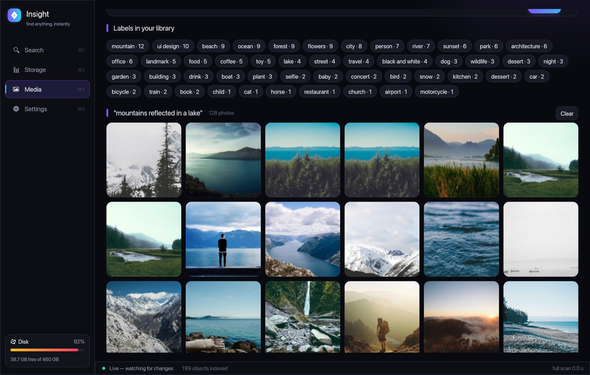

# Insight — find any file instantly (macOS · Windows · Linux)

A fast, private file search app in the spirit of *Everything* for Windows, built for macOS first and also
available for Windows and Linux. 100% Rust, one native binary, no Electron, no background daemon, no cloud.

It indexes every file on your computer in seconds, finds files as you type, shows where your disk space goes,
and lets you search your photos by what's in them, all on your own machine.


| Storage insights | Cleanup, biggest files, duplicates |
|---|---|
|  |  |

| Media labels | Search photos in plain language |
|---|---|
|  |  |

## Why use it?

Spotlight is built for "open that app" and document contents. It skips system and hidden folders, ranks
unpredictably, and can't tell you *where your 400 GB went*. Finder search is slow. Insight is a file finder that
does one job quickly.

- **Instant:** results update on every keystroke, in 2–10 ms across 2.6 million files.
- **Everything, really:** system folders, hidden dot-files, `node_modules`, app bundles, external drives you add.
- **Live:** file changes show up within a second (FSEvents on macOS, ReadDirectoryChanges on Windows, inotify on Linux).
- **Opens instantly:** the index is saved to disk, so a 2.6-million-file index is ready about 0.25 s after launch.
- **Storage insights:** a zoomable space map, space by type, largest files and folders, safe cleanup suggestions,
  and a duplicate finder that verifies with full content hashes.
- **Photos by content:** an on-device AI model labels your photos (beach, receipt, screenshot, dog…) and lets you
  search them in plain language (*"mountains reflected in a lake"*).
- **Private:** nothing is uploaded. The only network use is the one-time model download, and only if you
  turn the media feature on.

## Performance

Measured on a MacBook Pro (Apple M4 Pro, 12 cores, 24 GB, macOS 27), indexing the whole startup disk:
**2,630,000 files and folders**. Search times come from `insight --cli` with a warm index (best of 3).

| | Typical approach | Insight | |
|---|---:|---:|---|
| First full index of the disk | 94 s (`readdir` + `stat` per file, parallel) | **7.3–8.2 s** | ~12× faster |
| Launch to searchable (saved index) | full rescan | **0.25 s** | |
| Search `report` / `main.rs` | — | **3.9 / 4.2 ms** | |
| Search `ext:pdf size:>10mb` / `type:image dm:week` | — | **2.2 / 2.2 ms** | |
| Search `*.rs` (23,822 hits) / `IMG_????.jpg` | — | **2.7 / 5.4 ms** | |
| Search a path fragment `src/main` | — | **9.6 ms** | |
| Spotlight `mdfind -name main.rs` (for reference) | 50–70 ms | | narrower scope |
| Storage analysis (sizes, suggestions, largest) | — | **68 ms** | |
| Photo understanding (CLIP ViT-B/32) | — | **91 img/s** on the Apple GPU, 42 img/s on CPU | |
| App download | — | **12 MB** (universal macOS zip) | |

**Trade-offs, honestly:**
- **Memory:** about **600 MB** with 2.6M files indexed (around 230 bytes per file for names, metadata and the
  lookup table, plus the UI). Index fewer folders and it shrinks proportionally. The photo model adds about
  600 MB, and only once you open the Media tab.
- **The saved index takes disk space:** 134 MB for 2.6M files.
- **The first launch scans everything** (8 s here; slower on spinning disks or with many network mounts).
  Later launches are instant, then a background refresh catches changes made while Insight was closed.
  You can turn that off in Settings.
- **macOS privacy:** some folders (Mail, Messages, Safari…) only become visible after you grant
  **Full Disk Access**.
- **Linux live updates** watch your home folder, since inotify can't cheaply watch a whole disk. Other locations
  update on the next rescan.
- **Videos** are searchable by name, type, size and date, but the AI model labels still images only.
- The macOS app is ad-hoc signed, not notarized (no paid Apple developer account). The installer handles this.

## Features

**Search**
- Results on every keystroke, ranked by best match (exact name, then prefix, then word start), or sorted by
  name, folder, size or date.
- Filter chips: Folders, Images, Videos, Audio, Documents, Archives, Code, Apps.
- Matches highlighted in the results, plus a detail panel with a preview, size, dates, full path and AI labels.
- Keyboard first: type anywhere to search, ↑/↓ to move, **Enter** to open, **⌘/Ctrl+Enter** to reveal in
  Finder/Explorer, **⌘/Ctrl+C** to copy the path, **Esc** to clear. **⌘1–4** switch tabs.
- Right-click a result to open, reveal, copy the path or name, or move it to the Trash.

**Query syntax** (terms combine with AND; matching ignores case)

| Query | Meaning |
|---|---|
| `foo bar` | name contains *foo* and *bar* |
| `"foo bar"` | exact phrase |
| `!foo` or `-foo` | exclude |
| `jpg\|png` | either |
| `*.rs`, `IMG_????.jpg` | wildcards on the whole name |
| `src/main`, `path:projects`, `in:Downloads` | match the full path |
| `ext:pdf,docx` | by extension |
| `type:image\|video` | folder, image, video, audio, doc, archive, code, app, other |
| `file:` / `folder:` | only files / only folders |
| `size:>100mb`, `size:1mb..1gb` | by size |
| `dm:today`, `dm:week`, `dm:>2024-01`, `dm:old` | by date modified |
| `label:dog`, `label:receipt` | by AI photo label |
| `re:^IMG_\d+` | regular expression |
| `hidden:no` | skip dot-files |

**Storage**
- Disk usage rings and *space by type* (click a type to list its biggest files).
- **Space map:** a squarified treemap you can zoom into folder by folder, with animated transitions.
- **Cleanup suggestions** with sizes and SAFE / REVIEW badges: app caches, Xcode DerivedData and simulators,
  `node_modules`, Rust `target/`, Python caches and virtualenvs, package-manager caches (npm, yarn, pip, cargo,
  gradle, maven, Homebrew), Docker disk images, device backups, Trash, installers left in Downloads, and large
  files untouched for a year. Every item can be revealed first. Deleting always goes through the Trash, never
  permanently.
- **Biggest space users:** the largest files, and the largest folders that actually hold the data
  (not every parent of it).
- **Duplicate finder:** groups by size, then a quick sampled hash, then a full xxh3 content hash. Hard links
  are not counted as duplicates. Keep one copy, trash the rest.

**Media**
- Counts and sizes of images, videos and audio.
- **Labels:** 94 zero-shot categories (people, pets, places, food, documents, receipts, screenshots, UI
  designs, memes…), shown as a clickable cloud and searchable with `label:`.
- **Semantic search:** describe a photo in your own words.
- Analysis runs in the background and is incremental (changed photos are redone). It reads JPEG, PNG, WebP, GIF,
  BMP and TIFF, plus HEIC on macOS. Thumbnails load lazily, with fade-in animations.

**Design:** a dark, GPU-rendered interface with an animated sidebar, page transitions, staggered results,
glowing focus states, animated charts and five accent themes.

## Install (one copy-paste)

**macOS** (11+, Apple silicon and Intel) and **Linux** (x86_64): paste into Terminal:

```sh
curl -fsSL https://raw.githubusercontent.com/ehmoratallar8990/insightsapp/main/install.sh | bash
```

**Windows** 10/11 (PowerShell, no admin):

```powershell
irm https://raw.githubusercontent.com/ehmoratallar8990/insightsapp/main/install.ps1 | iex
```

The script downloads the latest release, installs it and launches it: `/Applications/Insight.app` on macOS,
`~/.local/bin/insight` plus a menu entry on Linux, and `%LOCALAPPDATA%\Programs\Insight` plus a Start-menu
shortcut on Windows.

Or download **Insight-macOS-universal.zip**, **Insight-Windows-x86_64.zip** or **Insight-Linux-x86_64.tar.gz**
from the [latest release](https://github.com/ehmoratallar8990/insightsapp/releases/latest).

<details><summary>Manual install (what the script does)</summary>

**macOS**
```sh
curl -fLO https://github.com/ehmoratallar8990/insightsapp/releases/latest/download/Insight-macOS-universal.zip
ditto -x -k Insight-macOS-universal.zip /Applications
xattr -dr com.apple.quarantine /Applications/Insight.app   # ad-hoc signed, not notarized
open /Applications/Insight.app
```
If you downloaded it with a browser instead: right-click **Insight.app → Open** the first time.

**Linux**
```sh
curl -fLO https://github.com/ehmoratallar8990/insightsapp/releases/latest/download/Insight-Linux-x86_64.tar.gz
tar xzf Insight-Linux-x86_64.tar.gz
install -m755 insight/insight ~/.local/bin/
```
Needs a desktop with OpenGL (X11 or Wayland).
</details>

## Uninstall

```sh
curl -fsSL https://raw.githubusercontent.com/ehmoratallar8990/insightsapp/main/uninstall.sh | bash
```
```powershell
irm https://raw.githubusercontent.com/ehmoratallar8990/insightsapp/main/uninstall.ps1 | iex
```

This removes the app and everything it stored: the index, the photo labels and the downloaded model. To keep
the data, append `-s -- --keep-data` to the `bash` above. Insight never changes anything outside its own data folder, except for
the files you choose to move to the Trash.

## Media intelligence

Open the **Media** tab and press **Download model & analyze**. Insight downloads OpenAI's
[CLIP ViT-B/32](https://huggingface.co/openai/clip-vit-base-patch32) once (about 600 MB, MIT license) and runs it
natively with [candle](https://github.com/huggingface/candle). It uses the Apple GPU through Metal on macOS and
the CPU elsewhere (build with `--features cuda` for NVIDIA).

- Every photo becomes a 512-number *embedding*, stored quantized (about 0.5 KB per photo).
- **Labels** compare each embedding against text prompts such as "a photo of a beach" or "a screenshot of a phone
  app". Changing the label list relabels the library from the stored embeddings, without reprocessing photos.
- **Semantic search** embeds your sentence the same way and returns the closest photos. Searching 100k photos
  takes a few milliseconds.
- The CLIP tokenizer is a small native port, and EXIF rotation is applied before analysis.
- Nothing about your photos ever leaves the computer.

## How it works

- **Index:** a struct-of-arrays layout. Each entry takes 32 bytes (name offset, parent, size, on-disk size,
  date, kind, flags), and all names sit in one contiguous buffer with a lowercased copy for matching. Parents
  always come before their children, so deleting a subtree or totalling folder sizes is a single linear pass.
- **Scanning:** a work-stealing parallel directory walk on its own thread pool. On macOS it uses
  `getattrlistbulk(2)`, which returns names, types, sizes and dates for a whole folder in a few system calls
  instead of one `stat` per file. That is where the 12× comes from. On Windows the folder listing already
  includes the metadata.
- **Search:** every keystroke runs a parallel scan of all names with SIMD substring search (`memchr::memmem`).
  Cheap filters run first, wildcards get a literal prefilter, and only path queries build full paths. Typing
  quickly drops stale queries, so only the newest one runs.
- **Live updates:** file-system events are debounced (250 ms) and applied to the index in place. A full background
  rescan swaps the new index in atomically and replays any changes made while it ran.
- **Snapshot:** saved with `bincode` and loaded in about 0.25 s for 2.6M entries.
- **UI:** [egui](https://github.com/emilk/egui) with a custom theme, GPU-drawn gradients, glows and animations,
  a virtualized results table, and a thumbnail cache that loads what is on screen first.

## Build from source

Requires Rust 1.95+ (`rustup update stable`).

```sh
git clone https://github.com/ehmoratallar8990/insightsapp && cd insightsapp
cargo run --release                    # run the app
cargo test --release                   # unit tests (walker, index, query engine)
./target/release/insight --cli "ext:pdf size:>10mb"   # headless search + timings
./target/release/insight --cli --storage              # headless storage analysis
./target/release/insight --classify photo.jpg         # print AI labels for images
```

- **macOS:** `./scripts/package-macos.sh` produces a universal, ad-hoc signed `dist/Insight.app` and zip.
- **Linux:** needs `libxkbcommon-dev libwayland-dev libxcb-render0-dev libxcb-shape0-dev libxcb-xfixes0-dev`.
- **Windows:** the MSVC toolchain.
- Optional features: `cuda` (NVIDIA GPU for the media model). `--no-default-features` drops the built-in
  model download (place the files in the data folder yourself).

**Releases:** `./scripts/release.sh 0.2.0` bumps the version, packages the macOS app, tags, pushes and publishes
the GitHub release. The [Release workflow](.github/workflows/release.yml) then builds and attaches the Windows and
Linux binaries. CI runs the tests on macOS, Windows and Linux for every push.

## Troubleshooting

- **Some folders are missing (macOS):** grant Full Disk Access in System Settings → Privacy & Security →
  Full Disk Access → add Insight, then click **Rescan now** in Settings.
- **"Insight can't be opened" (macOS, browser download):** right-click the app → **Open**, or run
  `xattr -dr com.apple.quarantine /Applications/Insight.app`.
- **Index external drives:** Settings → Indexed locations → add `/Volumes/YourDrive` (on Windows the drive
  letter, e.g. `D:\`).
- **Results seem stale:** Settings → **Rescan now**. The status bar shows whether live watching is active.
- **Start from scratch:** quit Insight and delete its data folder: `~/Library/Application Support/insight`
  (macOS), `~/.local/share/insight` (Linux), `%LOCALAPPDATA%\insight` (Windows).
- **Logs:** run from a terminal with `RUST_LOG=info insight`
  (macOS: `RUST_LOG=info /Applications/Insight.app/Contents/MacOS/insight`).

## License

MIT (see `LICENSE`). The CLIP model weights are © OpenAI, MIT license, downloaded from Hugging Face on demand
and not bundled. README demo photos come from [Lorem Picsum](https://picsum.photos) (Unsplash license).
